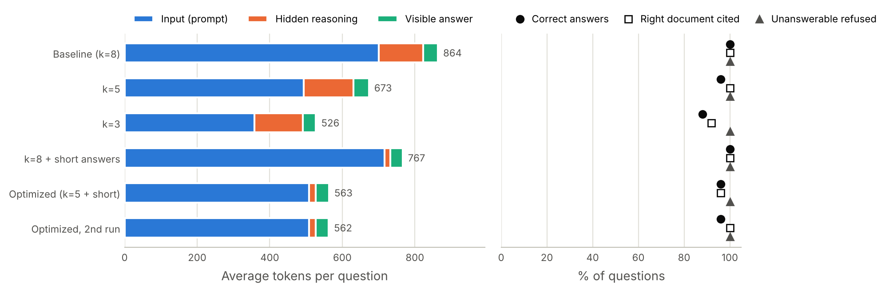

# Using fewer tokens without losing answer quality

This is my work for the imec internship exercise **2026-INT-298 (Token-efficient AI-agent design)**.
The full report is in [`report/report.pdf`](report/report.pdf).

## The idea

Last summer, during my internship at TDS, I built a RAG chatbot and I kept reaching Groq's daily token limit.
In this project I wanted to find out how many tokens I can save before the answers get worse. This time I count the tokens exactly, using the numbers that Groq gives back.

I tested two ideas, alone and together:

1. **Send fewer passages:** the search gives the model 5 document sections instead of 8.
2. **Short answers:** I ask for short answers, lower the model's "thinking" effort, and set a token limit just in case.

## What's in this folder

| File | What it does |
|---|---|
| `knowledge_base/` | 16 short documents for a fake research lab ("Kestrel Lab"): wiki pages, Teams chats, tutorials, rules and release notes. I made them with AI help, so I know the right answer to every question. |
| `questions.json` | 30 test questions: 24 that the documents can answer and 6 that they can't. |
| `retrieval.py` | Cuts the documents into sections and finds the sections closest to a question (TF-IDF search). |
| `assistant.py` | Sends the question and the sections to `openai/gpt-oss-20b` on Groq, and saves the exact token counts. |
| `retrieval_check.py` | A free check (no LLM): for each number of sections, does the search find all the facts needed? |
| `run_experiment.py` | Asks the 30 questions with 6 different settings (180 calls) and saves all the answers. |
| `scoring.py`, `evaluate.py` | Check the answers, then make the results table, the chart and a file to compare answers by hand. |
| `results/` | Everything from my run: all answers, the summary and the chart. |
| `report/` | The report (PDF and LaTeX). |

## The 6 settings I tested

k is the number of sections the search gives to the model.

| Setting | k | Answers |
|---|---|---|
| `baseline_k8` | 8 | normal answers, medium thinking, limit 2,048 tokens |
| `k5` | 5 | normal |
| `k3` | 3 | normal |
| `k8_short` | 8 | short: at most 3 sentences, low thinking, limit 400 tokens |
| `optimized_k5_short` | 5 | short |
| `optimized_k5_short_repeat` | 5 | short (the same setting again, to see how much answers change by luck) |

## How to run it

You need Python 3.10 or newer and a free Groq API key from [console.groq.com/keys](https://console.groq.com/keys).

1. Install the libraries:
   ```
   pip install -r requirements.txt
   ```
2. Add your key:
   ```
   copy .env.example .env
   ```
   (On Mac or Linux, use `cp` instead of `copy`.) Open `.env` and paste your key after `GROQ_API_KEY=`.
3. Run the scripts in this order:
   ```
   python retrieval_check.py
   python assistant.py
   python run_experiment.py
   python evaluate.py
   ```
   The first one is free and takes a few seconds. The second one asks one test question. The third one takes about 30 to 45 minutes on the free plan. The last one makes the table and the chart in `results/`.

If `run_experiment.py` stops (rate limit, internet, closed window), just run it again. It continues where it stopped.

## Results

The token numbers are averages per question. "Correct" and "Cited" are out of 24 questions, and "Refused" is out of the 6 questions with no answer in the documents.

| Setting | Input | Thinking | Answer | Total | Tokens saved | Cost saved | Correct | Cited | Refused |
|---|---|---|---|---|---|---|---|---|---|
| Baseline (k=8) | 701 | 122 | 40 | 864 | - | - | 24 | 24 | 6 |
| k=5 | 494 | 137 | 42 | 673 | 22% | 10% | 23 | 24 | 6 |
| k=3 | 358 | 133 | 36 | 526 | 39% | 24% | 21 | 22 | 6 |
| k=8 + short answers | 716 | 16 | 34 | 767 | 11% | 32% | 24 | 24 | 6 |
| **Optimized (k=5 + short)** | **509** | **18** | **36** | **563** | **35%** | **46%** | **23** | **23** | **6** |
| Optimized, 2nd run | 509 | 18 | 35 | 562 | 35% | 47% | 23 | 24 | 6 |



What I learned:

- The optimized version used **35% fewer tokens** and **46% less money**, and it got only one more question wrong (q21). My free check had already predicted this before any LLM call.
- The short-answer settings barely made the visible answers shorter. The big saving came from the model's hidden thinking, which went from 122 to 16 tokens. Output tokens cost 4 times more than input tokens, so this saved more money than sending fewer passages.
- With only 3 sections, the score dropped to 21 out of 24, so that was too few. But when a fact was missing, the model said "I couldn't find this" instead of making something up.

## How I used AI

I used Claude (Anthropic) as a helper. It wrote the code with me and helped fix the bugs, helped me find research papers, made the first drafts of the fake documents and test questions, and helped me write the report. I ran the experiment myself with my own Groq key, checked every answer whose score changed, and went through the code until I could explain each part.
